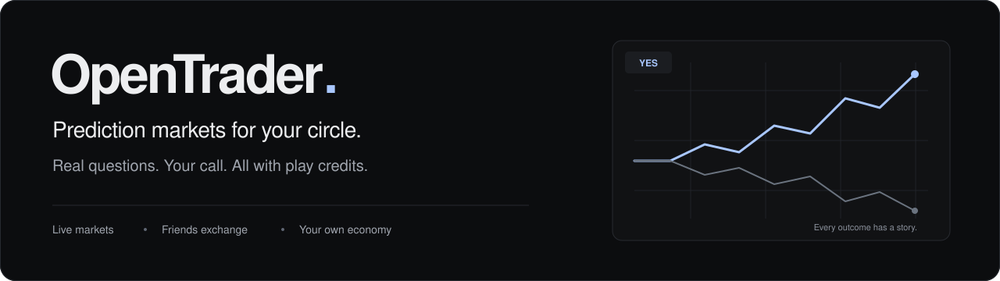
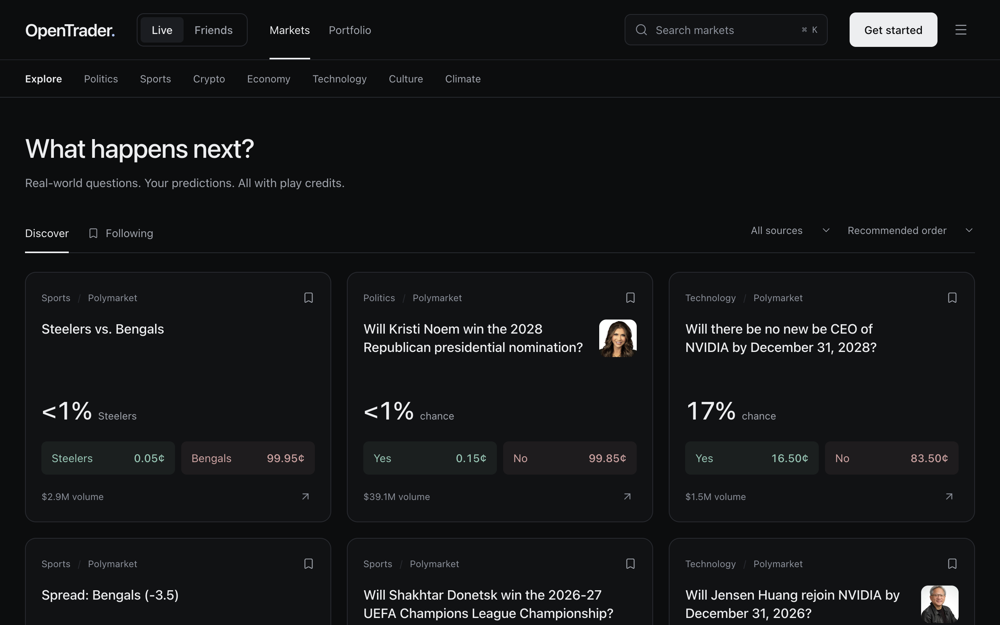
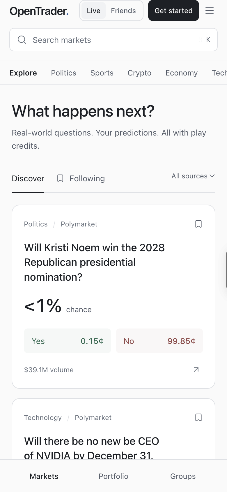
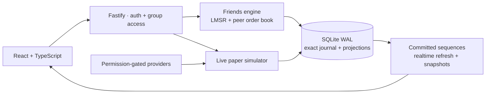

<p align="center">
  
</p>

<p align="center">
  <a href="https://github.com/desenyon/OpenTrader/actions/workflows/ci.yml"></a>
  
  
</p>

<p align="center">
  <a href="#get-started">Get started</a> ·
  <a href="#two-exchanges-one-place">The exchanges</a> ·
  <a href="#behind-the-market">Architecture</a> ·
  <a href="#documentation">Documentation</a> ·
  <a href="CONTRIBUTING.md">Contribute</a>
</p>

OpenTrader is a self-hosted prediction market for friend groups. Practice on public-market data, create questions for your own circle, and track who called it—with separate fictional-credit economies throughout.

**Free, nonredeemable credits. No deposits, withdrawals, prizes, leverage, or real-world orders.**

<a href="docs/verification/redesign/markets-desktop.png"></a>

<sub>Actual application capture from the browse-first release. Provider quotes are historical screenshot data; executable quotes must pass freshness checks.</sub>

## Get started

**Requires Node.js 24+ and npm.** Verified locally with Node 26. No API key, paid model, cloud database, or hosted account is required.

```sh
git clone https://github.com/desenyon/OpenTrader.git
cd OpenTrader
npm ci
npm run admin:create -- --handle admin
npm run dev
```

Open **[localhost:3000](http://localhost:3000)**. Your generated admin password is saved privately in `data/admin-credentials.txt`; it is never printed or committed. Sign in, then open **More options → Admin dashboard**.

New members request an account and wait for approval. First approval creates independent **10,000-credit Live and Friends wallets** and a private group. Reactivation and repeat approval never issue another allocation.

To trade with friends: invite them from **Friends → Manage group**, appoint an independent moderator and resolver, create a question with observable rules, and have the moderator approve it. The market maker provides initial liquidity even when no one has posted a limit order.

<details>
<summary><strong>Configuration and production commands</strong></summary>

```sh
cp .env.example .env
vim .env
npm run build
npm start
```

Production defaults to port **3000** unless overridden. The example `.env` uses development API port **3001**; change `PORT` when switching to production. Development serves the web app on **3000** and its API on **3001**. SQLite defaults to `data/opentrader.sqlite`.

The admin CLI reads `.env` and accepts `--database` and `--credentials`. It refuses to overwrite an existing credential receipt. After pruning development dependencies, use `node dist-server/create-admin.js --handle admin`.

For HTTPS hosting, configure `PUBLIC_ORIGIN` and `COOKIE_SECURE=true`. A Docker/Compose setup is also included:

```sh
docker compose up --build
```

Use one application instance with a persistent local volume. Take consistent SQLite backups, including active WAL state. Docker packaging is supplied; an image build is not claimed verified.

</details>

## Two exchanges. One place.

|                | Live Markets                                      | Friends Exchange                                     |
| -------------- | ------------------------------------------------- | ---------------------------------------------------- |
| **Questions**  | Public Polymarket/Kalshi markets                  | Original questions for approved group members        |
| **Prices**     | Validated provider bid/ask and depth              | Fixed-liquidity LMSR + price-time peer orders        |
| **Execution**  | Counterfactual paper fills; never sent externally | Owned shares, protected orders, and locked resources |
| **Economy**    | One account-level Live wallet                     | A separate wallet for each group                     |
| **Resolution** | Verified provider-final result                    | Independent resolver, evidence, and dispute review   |

Funds and positions stay inside their own exchange and group. Market prices express what trading implies; they do not guarantee an outcome.

### Built for making a call

- **Browse first.** Search, topics, source filters, watchlists, shareable questions, and source history.
- **Trade with a limit.** Size-aware previews, exact spend caps, average-price bounds, partial fills, GTC/GTD orders, cancellation, and expiry.
- **Know your position.** Cost basis, realized/unrealized P&L, indicative value, estimated liquidation value after slippage, and CSV journals.
- **Settle with evidence.** Frozen rules, creator-independent approval, a nontrading resolver, a 24-hour challenge window, impartial review, and a disclosed neutral-void policy.
- **Choose your trading identity.** Signup can hide your name in fills and rankings behind an alias per economy. Admins retain attribution; memberships, comments, and market roles stay named.
- **Keep score honestly.** Group returns and forecast calibration are separate. Extra credit allocations do not count as trading performance.

<details>
<summary><strong>See the mobile interface</strong></summary>

<p align="center">
  
</p>

The app supports desktop/mobile layouts, light/dark themes, keyboard-accessible dialogs, and a sticky mobile prediction action.

</details>

### Your exchange, your controls

The admin dashboard has five sections: **Accounts · Activity · Economy · Markets · History**.

Approve or suspend accounts, inspect placed orders and fills, review holdings and gross payouts alongside realized profit, adjust a specific wallet or free group budget, pause trading, cancel open orders, and halt/resume Friends markets.

Admin actions need no written reason. Actor, action, target, and prior state are recorded automatically. Reclaims cannot spend locked funds or reserved market subsidy. Suspension returns order locks while retaining positions for settlement. The last approved admin cannot be suspended.

## Behind the market



| Layer                | Built with                                                                     |
| -------------------- | ------------------------------------------------------------------------------ |
| Interface            | React 19, TypeScript, Vite, Lucide, Lightweight Charts                         |
| API & sessions       | Fastify, secure cookies, hashed passwords/sessions/invites, Zod                |
| Trading & accounting | Deterministic LMSR, peer matching, `decimal.js`, integer microcredits          |
| Persistence          | Node's SQLite, WAL/FULL durability, ACID transactions, immutable journals      |
| Verification         | Vitest, property/adversarial tests, packaged-server smoke, isolated benchmarks |

Transactions protect cash, owned shares, locks, order status, and idempotency together. Only committed sequences reach clients. Stale source books disable execution; reconciliation mismatches stop new trading.

## Verify it yourself

```sh
npm test
npm run build
npm run test:production
npm run benchmark
```

The latest local verification passed **152 tests across 20 files**, TypeScript/build, and the packaged production smoke. The smoke exercises anonymous signup, reason-free admin approval, separate wallets, reports, and reconciliation against a disposable database.

The [measured local benchmark](docs/verification/admin-economy.md#performance-sample) used **100 users and 1,000 open markets** with all submitted orders succeeding and every reconciliation flag passing. It excludes network/TLS, browser rendering, external feeds, and sustained load; it does not establish production capacity.

### External data has a permission gate

Friends works independently of provider feeds. **Hosted external-data mode defaults off.** Enabling it requires both `LIVE_DATA_ENABLED=true` and `DATA_USE_ACKNOWLEDGED=true` after reviewing data-use rights. Free public APIs do not themselves authorize redistribution.

See the provider references in [third-party notices](THIRD_PARTY_NOTICES.md) and the [implementation verification](docs/verification/README.md). Source corrections require separately appointed, historically nontrading reviewers and a finite correction reserve.

## Documentation

| Start here                                                           | What it covers                                                        |
| -------------------------------------------------------------------- | --------------------------------------------------------------------- |
| [Privacy & admin cleanup](docs/verification/trading-privacy.md)      | Anonymous aliases, reason-free actions, and latest automated evidence |
| [Administration & economy audit](docs/verification/admin-economy.md) | Approvals, balances, locks, settlement, and benchmark methodology     |
| [Browse-first interface](docs/verification/redesign.md)              | Navigation, screenshots, and earlier browser coverage                 |
| [Engine verification](docs/verification/README.md)                   | Economic rules, adversarial flows, and operating boundaries           |
| [Contributing](CONTRIBUTING.md)                                      | Local workflow and changes to trading behavior                        |
| [Security](SECURITY.md)                                              | Private vulnerability reporting and useful report details             |

The implemented Friends engine uses whole contracts and binary markets on a single durable host. Multi-host operation, arbitrary N-way markets, full-set conversions, margin, and real-world execution are outside the current release. Historical design concepts remain under `docs/design` and are not screenshots of current functionality.

---

<p align="center">
  Built by <a href="https://github.com/desenyon">@desenyon</a> ·
  <a href="THIRD_PARTY_NOTICES.md">Third-party notices</a> ·
  <a href="https://github.com/desenyon/OpenTrader/discussions">Discussions</a>
</p>
