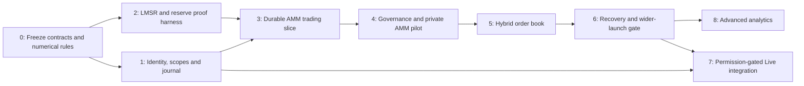

# OpenTrader Implementation Plan

> **For agentic workers:** Once the proposed design is approved and implementation is requested, use superpowers:executing-plans or an explicitly selected subagent-driven workflow to implement one reviewed milestone at a time. Checkboxes below describe future work; none is claimed complete.

**Goal:** Deliver an invitation-only fictional-credit Friends Exchange with reproducible pricing, protected orders, independently reviewed settlement, and auditable isolated economies; subsequently add hybrid matching and a permission-gated Live simulator.

**Architecture:** A Next.js client talks to authenticated group APIs and a durable trading service. PostgreSQL atomically owns journal entries, projections, locks, market state, idempotency, jobs, and the transactional outbox. Friends AMM/hybrid execution and external simulation share accounting primitives but have separate execution paths and scoped wallets.

**Tech stack:** TypeScript/Node, Next.js/React, Tailwind/accessibility primitives, Zod, PostgreSQL, managed identity, independently verified decimal math. Exact dependency versions and deployment vendors are selected and pinned at implementation kickoff; no dependencies are installed by this plan.

**Spec:** [Product analysis and proposed architecture](2026-11-13-product-analysis.md), interpreting the user's November 12 v1.0 specification. Proposed simplifications and unresolved release blockers are identified there.

## Global constraints

- Credits are free, fictional, non-purchasable, nonredeemable, and have no prizes or external transfer path. No deposits, cash-out, leverage, shorting, brokerage connectivity, or external execution.
- Friends scope = group + season + member. Live scope = independent Live season + member. Every economic operation remains inside one scope.
- Proposed first precision version: cash 6 decimals in integer microcredits; whole-share quantity; 4-decimal limit-price tick; zero Friends fees; uniform fixed-b binary LMSR.
- Posted journals are immutable, balanced per asset, and replayable. Available member balances are nonnegative; issuer/issuance accounts use explicitly defined liability semantics.
- All trading mutation routes require an idempotency key and engine/rule version. Quotes expire and are atomically revalidated against user protections.
- All scheduled economic actions are persisted and idempotent. Every committed order is recoverable after a worker restart or unknown HTTP result.
- External ingestion, caching, display, and execution default OFF until the applicable data-use permission gate passes.
- Resolver/reviewer conflicts and a no-quorum longstop are frozen before opening. No administrative role silently bypasses trading or settlement invariants.
- Scope of this work is planning and generated concepts. No product implementation or deployment is authorized by inference from these checklist items.

## Review focus

1. Duplicate join/rejoin and concurrent invite redemptions must never issue extra credits or exceed invite capacity: owned by M1.
2. An order timeout after commit must return the original economic result on retry, including after restart: owned by M3/M6.
3. A member removal, market close, order expiry, or dispute arriving at the same instant as a competing action must have a reproducible authoritative winner: owned by M3/M4/M6.
4. Outcome changes must recheck resting orders across both books without double-locking resources or creating an unbounded cascade: owned by M5.
5. Correcting a result after payouts were spent must not create negative member cash or an unbalanced journal: owned by M4/M7.

## Proposed repository structure

This is a target structure for the empty workspace, not files that already exist.

```text
apps/
  web/                         # pages, accessible UI, private client cache
    src/features/{groups,markets,trading,portfolio,governance,inbox}/
  api/                         # sessions, authorization, typed HTTP commands
  exchange/                    # durable command loop, jobs, realtime gateway
packages/
  contracts/                   # string amounts, IDs, command/event schemas
  authz/                       # group scopes, membership and conflict policies
  db/                          # migrations, restricted roles, transaction helpers
  ledger/                      # balanced posting, holds, projections, replay
  friends-engine/              # fixed-b math, AMM, later routing/order book
  live-simulator/              # depth walking and simulator policy only
  market-data/                 # permission gate, version-aware provider adapters
  governance/                  # lifecycle, proposals, disputes, corrections
  analytics/                   # basis, marks, exit values, calibration
tests/
  reference/                   # independent Decimal math oracle
  integration/                 # real PostgreSQL ACL and atomicity tests
  concurrency/                 # competing transactions, crash/retry tests
  scenarios/                   # replay, bounds, cascades, outage cases
  accessibility/               # critical keyboard and assistive flows
docs/design/                   # this analysis, plan, concepts, prompt provenance
```

Keep packages small until there is a boundary to enforce. Do not create empty services merely to match this tree. Share schemas, exact-amount types, accounting primitives, and policy versions; do not share a single generic matching implementation between Friends and Live.

## Interface decisions

Use transport strings for exact amounts and runtime-validated opaque IDs. Inside the engine, `Microcredits`, `WholeShares`, and `PriceTicks` are distinct branded integer types. Outcome IDs are immutable; APIs never accept array indexes as identifiers.

| Owner | Proposed interface / contract | Used by |
| --- | --- | --- |
| contracts/authz | `authorizeScope(session, scope, action): Promise<AuthorizedScope>` | Every read, command, and subscription |
| ledger | `postJournal(tx, journal: BalancedJournal): Promise<PostedJournal>`; `reconcileScope(tx, scope): Promise<Reconciliation>` | Allocations, fills, holds, settlement, audit |
| Friends math | `quoteAmm(state, outcomeId, side, qty): AmmQuote` with exact quantity, conservative cash units, mathematical interval, next q and indicative prices | Quote API, router, simulations |
| trading service | `submitOrder(command: ProtectedOrderCommand): Promise<OrderReceipt>` | API forwards authenticated scoped commands; only service posts execution |
| governance | `advanceMarket(command: LifecycleCommand): Promise<LifecycleReceipt>` | Close/expiry/resolve/dispute/review jobs and APIs |
| realtime | `MarketBatch { marketId, sequence, schemaVersion, events[] }`; separate `AccountBatch { userId, cursor, events[] }` | Snapshot recovery and private account streams |
| external data | `validatedSnapshot(scope, providerMarketId, outcomeId): Promise<ExecutableSnapshot>` | Live simulator only after permission/status/freshness checks |

`ProtectedOrderCommand` includes principal and wallet scope derived by the server, outcome ID, BUY/SELL, quantity, price limit, IOC/GTC/GTD, expiry if applicable, total spend cap or minimum proceeds, minimum fill, quote reference, expected state, versions, and idempotency key. The client may not override trusted principal/scope values.

## Milestone dependency graph



Provider permission review can proceed independently from M0 onward. Actual provider integration remains gated. Basic portfolio, export, forecasts, and rankings belong in the pilot; only advanced analytics wait for M8.

## M0. Freeze contracts, economy, governance and numeric domain

**Deliverable:** Small versioned decision records and fixtures an engineer can implement without inventing economic policy.

**Files:** `packages/contracts/src/{amounts,orders,events,scope}.ts`, `docs/decisions/{precision,economy,resolution,corrections}.md`, `tests/reference/fixtures/`.

- [ ] Confirm or revise the proposed binary/whole-share first release, tick, microcredit rounding, min/max order sizes, per-market order/work caps, supported b range, supported numerical domain, and exact safe-rounding error envelope.
- [ ] Freeze season admission/allocation, treasury funding, reserve-return formula, and whether maker profits remain reusable sponsor funds. Distinguish a new member's initial allocation from a forbidden mid-season top-up to existing members.
- [ ] Freeze conflict eligibility, two-person review, no-quorum/abandonment longstop, override approvals, correction funding and negative-balance prohibition. Define who operates any platform review pool.
- [ ] Freeze API error codes and requote behavior, minimum-fill semantics, strict deadline boundaries, and market/public-account stream separation. Freeze forecast scoring cutoff, early publicly determined outcomes, last-eligible-revision selection and ineligible-market handling.
- [ ] Write original synthetic market fixtures and the independently calculated b = 500 / 100 YES example. Include binary win/loss/void journals and a correction after spending.

**Gate:** Decisions state exact behavior for boundary inputs; no unresolved economic choice is hidden in an implementation task. N-way exact-void rounding and external data permission remain explicit later blockers.

## M1. Identity, invite-only scopes, wallets and balanced journals

**Deliverable:** A signed-in user can redeem one invitation, join a private group, see the correct 10,000-credit wallet, and export an issuance receipt. A nonmember cannot enumerate or read private resources.

**Files:** `packages/db/migrations/`, `packages/authz/src/`, `packages/ledger/src/{post,holds,reconcile}.ts`, `apps/api/src/{sessions,groups,invites,wallets}/`, `apps/web/src/features/groups/`, `tests/integration/{scope,invites,ledger}.test.ts`.

- [ ] Write failing PostgreSQL integration tests for unbalanced transactions, cross-scope references, duplicate Live wallets with null group, duplicate season allocation, and unauthorized REST reads.
- [ ] Implement schema constraints, partial unique indexes, immutable journal posting, issuer/issuance role rules, and derived available/held balances.
- [ ] Implement managed-session validation, invite hashing, atomic capped redemption, verified-email restrictions, join/rejoin, and explicit finite sponsor allocation.
- [ ] Add server-side scoped CRUD/read policies and nonprivileged RLS tests; verify privileged jobs cannot accept client-injected account IDs.
- [ ] Implement the group selector, exchange education, wallet badge, token error states, and original group/season settings UI. No live feed requests.
- [ ] Verify 100 parallel redeems of a one-use invite produce exactly one membership admission; 100 duplicate allocations produce one issuance. Rejoining the same season yields no additional credits. Test revoked/expired/forwarded-email invites.
- [ ] Review journals and permissions before proceeding; commit only the verified milestone.

**Gate:** All entries balance per asset; scopes cannot cross by guessed IDs; no allocation duplication; all initial issuance is explicit and replayable.

## M2. Pure LMSR math, executable lots and reserve accounting

**Deliverable:** A deterministic math package with an independent numerical oracle and a bounded-loss scenario report. No UI-only pricing authority.

**Files:** `packages/friends-engine/src/{precision,lmsr,quote,reserve}.ts`, `tests/reference/lmsr_oracle.py`, `tests/scenarios/{lmsr-properties,rounding-loops,reserve-loss}.test.ts`.

- [ ] First create reference tests for 52.495844410823… cost, 0.549833997312… final YES price, upward debit 52.495845, downward undo 52.495844, and upward reserve 346.573591.
- [ ] Implement stable log-sum-exp / stable cost deltas with immutable outcome IDs, fixed b, deterministic arithmetic settings, supported-range checks, and safe rounding that accounts for approximation error.
- [ ] Verify probabilities, monotonicity, pre-rounding telescoping, immediate undo state restoration, and integer round-trip non-profit. Reject invalid b, unsupported precision, nonwhole quantity, unknown outcomes, out-of-range input and invalid state.
- [ ] Simulate random buy/sell paths with owned-share-only sells and every binary terminal outcome; assert no maker loss exceeds the provisioned bound. Report seed, number of paths, worst observed loss, and all rejected inputs; simulation supplements the analytical bound.
- [ ] Test tiny permissible orders, large inputs within the supported domain, near-extreme prices, long subdivided paths and numeric-boundary rounding. Ensure unsupported cases fail closed rather than falling back to floats.
- [ ] Verify escrow funding/return scenarios: full loss, full profit, partial sales, void and no trades; no double release or reusable spent subsidy.

**Gate:** Oracle tolerance and conservative rounding criteria from M0 pass, integer cash conserves, and the independent analytical reserve argument is documented. If numerical error cannot be bounded, do not open trading.

## M3. Durable Friends AMM vertical slice

**Deliverable:** Create/review/open a binary market, request a protected quote, buy/sell owned shares, receive committed updates, and view scoped positions and receipts.

**Files:** `apps/exchange/src/{commands,transactions,outbox,jobs}/`, `packages/friends-engine/src/execute-amm.ts`, `apps/api/src/{markets,quotes,orders}/`, `apps/web/src/features/{markets,trading,portfolio}/`, `tests/concurrency/amm-orders.test.ts`.

- [ ] Write failing integration tests for 100 simultaneous spends against one nearly empty wallet, duplicate request keys, payload mismatch, stale quotes, overselling locked shares, and worker failure around commit.
- [ ] Implement serialized market transactions, sorted account locking, exact escrow/share journal operations, idempotency response storage, and bounded whole-transaction retries.
- [ ] Implement DRAFT → REVIEW → OPEN approval with separate reviewer, frozen rules, resolver eligibility, finite treasury check, escrow transfer and fixed precision/b. No post-open substantive edits.
- [ ] Implement protected IOC buys/sells, minimum-fill rollback, hard cash/proceeds constraints, quote expiry and inline close/membership checks. Return exact receipts and explicit requote errors.
- [ ] Implement committed public market batches and separate authorized private wallet streams. Gap detection pauses delta application until an authorized snapshot is loaded.
- [ ] Implement desktop market detail and mobile review from the concepts, with exact expandable amounts, indicative-versus-executable labels, win/loss/void payouts, accessible controls and no-value labels.
- [ ] Add basic cost basis, indicative position marks, AMM liquidation estimate, own audit export, and settled activity shell. Never sum wallets into spendable funds.
- [ ] Verify buy/undo conservation, quote changes, same-key retry after restart and unknown commit, concurrent group removal, delayed close job, two-client sequence recovery, and rejection of foreign-group subscriptions.

**Gate:** A five-person synthetic group can trade against an empty peer book with no overspend, duplicate share issue, wallet crossover, hidden float arithmetic, or uncommitted broadcast.

## M4. Resolution, moderation, social basics and AMM pilot

**Deliverable:** One full market lifecycle through independent finalization or void; a five-person pilot can use the product without manual database edits.

**Files:** `packages/governance/src/{lifecycle,conflicts,disputes,settlement,corrections}.ts`, `apps/exchange/src/jobs/{close,resolve,review}.ts`, `apps/api/src/{resolutions,disputes,reports,comments,notifications}/`, `apps/web/src/features/governance/`, `tests/integration/governance.test.ts`.

- [ ] Write failing tests for a creator resolving, a former position holder resolving, expired/early finalization, dispute-versus-finalize race, repeated settlement, removed-member payout, quorum failure and correction after spending.
- [ ] Implement persisted close/cancel, resolver evidence proposal, database-timed challenge deadline, timely dispute freeze, two independent reviewer votes, recusal and published no-quorum/abandoned-market longstop.
- [ ] Post binary win/loss/void cash settlement and share retirement once, reconcile escrow, return actual unused sponsor funds, and archive the immutable resolution receipt.
- [ ] Implement dual-approved corrections with explicit reserve funding; never rewrite historical fills or force a member balance below zero. Alert affected users.
- [ ] Implement prohibited-content and opt-in subject policy, moderator review queue, reporting, comment moderation, private evidence ACLs, upload restrictions, and privacy/deletion request handling. Define retention/anonymization rules before storing minors' personal information.
- [ ] Add basic group chat/comments, in-app notification preferences, resolver requests, closing/finalization notices, separate game P&L ranking, append-only declared forecast revisions, Brier score and eligible-question counts. Freeze a cutoff no later than trading close/observation deadline and exclude revisions at or after an independently evidenced earlier public answer; score the last eligible revision, never a post-answer submission. If early-answer timing is unreliable, exclude that market from calibration with a reason.
- [ ] Verify that a certain forecast submitted after an early public release, during a dispute window, or after the frozen cutoff earns no score; revising a forecast never permits cherry-picking the best historical probability.
- [ ] Verify a removed user's live session loses subscriptions and future reads while their settlement still posts. Verify evidence URLs are unusable outside the case/group scope and after expiry.
- [ ] Run keyboard, mobile layout and light/dark checks for invite → trade → dispute → receipt; reconcile all pilot journals after scripted scenarios.

**Gate:** No conflicted resolution, no payout before dispute expiry, dispute reliably freezes payout, every economic action replays, and users can see moderation/failure states. This permits a constrained AMM-only private pilot, not a full hybrid-launch claim.

## M5. Hybrid CLOB and AMM routing

**Deliverable:** Owned-share-backed peer orders with exact locks, price-time priority, mixed integrated AMM fills, partials, cancellation and expiry.

**Files:** `packages/friends-engine/src/{book,router,crossing,resting-rechecks}.ts`, `packages/ledger/src/order-locks.ts`, `apps/exchange/src/commands/{submit,cancel,replace,expire}.ts`, `apps/web/src/features/trading/{book,depth,resting-orders}/`, `tests/concurrency/hybrid.test.ts`.

- [ ] Write deterministic fixtures for same-price FIFO, peer ties favored over AMM, a marginal-versus-integrated one-lot crossing, mixed-source fills, and both directions of outcome-price changes.
- [ ] Implement buy cash holds, sell owned-share holds, immediate marketable execution, GTC/GTD remainder, atomic cancel/replace losing priority, and batch cancel for close/removal/suspension.
- [ ] Implement discrete-lot monotonic crossing search with exact terminal verification, per-order price/total protections, self-match exclusion, and stable cross-outcome resting-order reevaluation.
- [ ] Persist all triggered fills, receipts, balances and events atomically under one market batch. Enforce published work caps without an unprotected partial commit.
- [ ] Add consolidated executable depth, separate AMM/last-trade charts, own holds and open orders, cancel receipts, and partial-fill labels to the UI.
- [ ] Fuzz buy/sell/replace/cancel/expiry and concurrent market orders across wallets and markets. Assert no double holds, no oversell, no self-match, P2P q unchanged, issued supply reconciles, sponsor escrow remains solvent, and replay yields exactly the same state.
- [ ] Test cancel/fill races, replacement reserve failure, expired best order, market close during queue backlog, and idempotent retry of a request that triggered other users' resting fills.

**Gate:** Acceptance criteria 5–7 pass with real PostgreSQL concurrency and replay evidence; whole-lot routing satisfies both execution quality and published limits.

## M6. Hardening, observability and wider Friends launch

**Deliverable:** Recoverable, observable operation with verified backups, reconciliation, quotas and measured latency.

**Files:** `apps/exchange/src/{reconciliation,circuit-breakers,health}/`, `tests/scenarios/{restart,replay,restore,realtime}/`, `tests/concurrency/load/`, `docs/runbooks/`.

- [ ] Implement daily and on-demand journal/projection/supply/hold/escrow reconciliation and clear scoped circuit breakers. A mismatch halts affected execution and preserves evidence.
- [ ] Instrument accepted/rejected/duplicate orders, retry counts, queue age, lock wait, publish lag, sequence gaps, resolution backlog, reserve utilization and correction funding. Scrub secrets/private evidence from logs.
- [ ] Kill workers before and after commit and before outbox acknowledgement; restart and verify exactly one economic execution and repeat-safe event delivery. Redis/publisher loss must not lose committed balances or orders.
- [ ] Restore a database backup to an isolated environment; reconcile it and document actual recovery point/time. Exercise signing-key/session and permission revocation procedures without exposing secrets.
- [ ] Benchmark 20-member groups plus at least 100 concurrent active users and 1,000 open synthetic markets. Measure p50/p95/p99 accepted-order latency, rejection rates, backlog and lock contention; compare p95 with the proposed 400 ms target without asserting capacity in advance.
- [ ] Run adversarial group/WS ID-guessing, CSRF/session, stored-XSS/Markdown, evidence URLs/uploads, invite brute force, rate-limit and audit-export checks.
- [ ] Verify every Friends acceptance criterion against an evidence record, including inaccessible groups, wallet separation, both fill sources, all settlement branches and forecast/P&L separation. Document remaining Live and N-way exclusions.

**Gate:** No unresolved balance/supply discrepancy; tested recovery and authorization; real benchmark results and actionable operational alerts. 99.9% availability remains a service target until observed, not a result of a passing test run.

## M7. Live simulator, only after rights clearance

**Deliverable:** Independently priced counterfactual immediate execution from authorized external depth, with an entirely separate practice economy.

**Files:** `packages/market-data/src/{permissions,normalizer,freshness,polymarket,kalshi}/`, `packages/live-simulator/src/{walk-book,fees,settlement}.ts`, `apps/exchange/src/jobs/provider-feeds/`, `apps/web/src/features/live/`, `tests/scenarios/providers/`.

- [ ] First document the intended ingestion, redistribution, caching, derived displays and audit retention rights for each provider and surface. Record explicit approvals where needed, expiry/revocation and attribution. Without clearance, keep the feature disabled and use only original synthetic fixtures.
- [ ] Write fixture tests for event/market separation, explicit v1/v2 identifier selection, unknown protocol rejection, Kalshi complementary asks/fixed-point values, empty books, bad ticks and mismatched outcome mappings.
- [ ] Implement the provider interface and allowlisted adapters, rate-limit/backoff, heartbeat/reconnect/fresh snapshot, order normalization, hash/version checks and retention jobs. Never scrape to bypass restrictions.
- [ ] Implement protected IOC depth walking, partial/reject policy, owned-position sells, disclosed simulator cost policy, source/receive-age and clock-skew validation. Each account independently consumes a counterfactual snapshot; simulated orders never mutate external data.
- [ ] Implement provider-final-only settlement and separately funded correction policy; preliminary/disputed source outcomes cannot settle positions.
- [ ] Add provider attribution, exact source rules/links, stale/empty/halted/unavailable states, separate Live wallet/ranking and clear counterfactual-fill labels. No fake live prices or undisclosed queue simulator.
- [ ] Verify five-second default freshness cutoff, permission revocation while clients are connected, stale upstream/fresh local timestamps, out-of-order/duplicate messages, reconnect mapping changes, insufficient depth, reversal after spent payout and complete economic separation.

**Gate:** All external usage permitted for its actual purpose, current adapter fixtures validated, stale/ambiguous states fail closed, and Live ledger/simulation/settlement reconciles. Friends availability never depends on a provider feed.

## M8. Advanced analytics and later outcome expansion

**Deliverable:** Inspectable decision support and richer outcomes without changing published economics.

**Files:** `packages/analytics/src/{exit-value,drawdown,calibration,scenario,anomalies}.ts`, `apps/web/src/features/analytics/`, `tests/scenarios/analytics/`.

- [ ] Extend baseline portfolio to consolidated full-size liquidation estimates, concentration, periodic drawdown, season/cohort comparison and audit download. Quote previews must not execute or alter q.
- [ ] Extend forecast scores to multiclass Brier/log score with declared epsilon, the M4 eligibility rules, participation coverage, and uncertainty for sparse data. Keep scoreboards distinct from simulated profit.
- [ ] Add deterministic liquidity calibration, extreme buys/all-users-sell/early-close/no-quorum/source-outage scenario reports, and advisory anomaly flags. No opaque model changes execution, reserves or resolution.
- [ ] Before N-way markets, freeze rational void entitlement and residual accounting, publish revised acceptance wording, test exhaustive-outcome validation and stable outcome IDs, extend cross-outcome router rechecks and bounded-loss tests. Do not enable fractional quantities or full-set mint/merge implicitly.

**Gate:** Every figure traces to data and formulas; scenario runs reproduce; no forecast/anomaly model moves credits or chooses a winner; the amended N-way payout contract passes exact journal checks.

## Acceptance-criteria mapping

The input specification's numbered criteria map as follows. This prevents a narrow pilot from being mistaken for the full product.

| Input criterion | Evidence owner |
| --- | --- |
| 1: private REST/WS resources | M1, M3, M4, M6 adversarial access checks |
| 2: independent wallets | M1 scope constraints; M3 cross-wallet orders; M7 Live isolation |
| 3: immutable binary market and funded reserve | M2 reserve harness; M3 approval transaction |
| 4: empty-book reference purchase | M2 oracle; M3 end-to-end protected trade |
| 5: peer priority without q mutation | M5 matching and journal fixtures |
| 6: mixed-source integrated routing | M5 lot-boundary, budget and partial-fill fixtures |
| 7: simultaneous-order safety | M3/M5 concurrency; M6 recovery/load |
| 8: identical or recovered updates | M3 batch contract; M6 gap/reconnect tests |
| 9: recusal/dispute/evidence | M4 conflict, race and immutable-receipt checks |
| 10: exact win/loss/void | M4 binary; M8 amended rational policy before arbitrary N-way |
| 11: balanced replayable movement | M1 posting; M3/M4/M5 journal operations; M6 replay |
| 12: external gate/freshness/mapping | M7, with feature disabled until passing |
| 13: P&L versus calibration | M4 baseline; M8 advanced cohort/scoring checks |
| 14: fictional credits, no real-money capability | M1/M3/M4 screen review; M6 boundary/security review; M7 isolated simulator |

## Effort and rollout assumptions

Rough planning range, not a delivery commitment: with two experienced full-time engineers and part-time product/design/security support, an AMM-only governed private pilot could require roughly 8–12 weeks; a hardened hybrid Friends release could require roughly 12–18 weeks total. Independent numerical review, privacy requirements and actual operational reviewer capacity can extend either. A Live integration may add roughly 3–6 engineering weeks after clearance; rights negotiations have no assumed deadline. These estimates are judgment, not measured velocity from an existing codebase.

Roll out to internal synthetic accounts, then a single invited group, then a few monitored groups, then wider invitation access after M6. Publish exact release scope and known limitations at each step. Do not advertise all fourteen criteria complete before their evidence exists. Keep the provider kill switch and market-scoped emergency halt available throughout.

## Before beginning implementation

Review the proposed economic decisions, especially whole-share binary launch, finite season sponsor allocation, reviewer/void fallback and correction funding. Then begin with M0/M1 and the independent math harness. Actual command names, CI configuration and dependency lockfiles will be established during that work; none is represented here as an already working test command.
