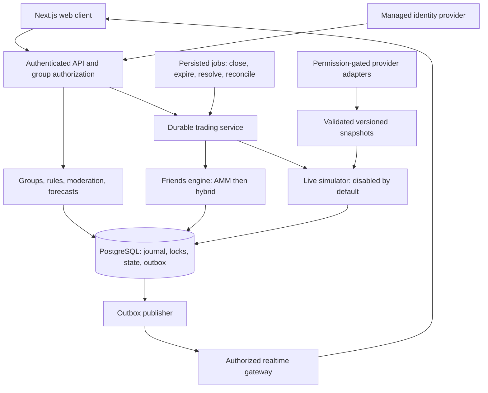

# OpenTrader: product analysis and proposed architecture

Date: November 13, 2026. Status: design proposal for review, not implemented or approved for release.

Input: the user's Private Prediction Market v1.0 specification dated November 12, 2026. The workspace was empty at inspection. The recommendations below fill open decisions; they are not previously agreed requirements. No product code, infrastructure, accounts, or provider integrations were created.

## 1. Recommendation

Build a private forecasting game with exchange-grade accounting. Launch Friends Exchange with binary LMSR markets, immutable rules, funded market escrow, independent resolution, and a complete audit trail. Add resting orders only after that vertical slice survives concurrency and recovery tests. Present Live Markets as unavailable until the data-use gate is explicitly satisfied.

The specification's strongest decisions are separate economies, owned-share-only selling, fixed-b LMSR, balanced journals, bounded orders, independent resolution, and an external licensing gate. Preserve them. The largest implementation risk is treating the full specification as one frontend project: matching, accounting, governance, and external simulation have different correctness obligations.

Three approaches were considered:

| Approach | Benefit | Cost / limitation |
| --- | --- | --- |
| Full hybrid exchange and external mirror at launch | All destinations immediately useful | Couples four difficult systems; licensing can block the whole launch; broadest failure surface |
| **Friends AMM first; hybrid next; licensed Live later** | A small group can trade immediately; proves custody-free virtual accounting and resolution before routing complexity | Early pilot has no peer resting orders; must clearly label release scope |
| Clickable frontend with invented balances | Fast visual feedback | Cannot establish trading correctness, wallet isolation, or settlement; suitable only as a labeled prototype |

Recommendation: the second approach. This is a recommendation, not a claim that the user selected it. The generated images are design artifacts only. AMM-first launch is a subset of the spec, not completion of its fourteen acceptance criteria.

## 2. Decisions to freeze before product code

| Decision | Proposed initial rule | Reason |
| --- | --- | --- |
| Launch outcomes | Binary YES/NO only | Exact binary void payouts and smaller governance/routing surface; exhaustive N-way markets remain planned |
| Cash | Integer microcredits: 1 credit = 1,000,000 units | Exact journal arithmetic; decimal strings at API boundaries; no JS Number for amounts |
| Shares | Whole contracts; minimum and lot = 1 contract | Peer trades at the proposed tick settle exactly; fractional quantities deferred |
| Price tick | 0.0001 credits; user limits from 0.0001 to 0.9999 | Clear 0.01 percentage-point limit increments; outcome payout remains exactly 1 credit |
| LMSR math | Deterministic high-precision decimal module with independently checked error bounds | Transcendental functions need more than integer storage; safe rounding must be justified |
| Cash rounding | AMM buy debit upward; AMM sell credit downward to microcredit | Prevents rounding-only buy/undo gains; retain and reconcile residuals in maker escrow |
| Peer settlement | Quantity × 4-decimal price; same exact amount credited and debited | Whole contracts make each peer cash amount an integer multiple of 100 microcredits |
| Initial credits | 10,000 per member per group season; 10,000 per Live season | Explicit issuance journal and unique allocation key; leaving/rejoining never issues again |
| Fees | Zero Friends platform fees at launch | Simplifies costs and reconciliation; future changes versioned and disclosed |
| Liquidity | Uniform prior; fixed b; proposed b = 500 for example markets | Published reserve calculation and immutable pricing; lower b configurable before approval |
| Sponsor budget | Explicit finite season allocation; no automatic refill | User issuance and sponsor issuance are separate, visible entries; owners cannot mint funds through a settings edit |
| Review deadlines | 24-hour challenge; 48-hour independent review | Frozen before opening; database time is authoritative |
| Missing impartial quorum | Predeclared platform review pool; otherwise neutral void at the frozen longstop | Small groups cannot always supply two independent reviewers; creator cannot substitute themselves |
| Removed member | Block access and trading immediately; cancel orders; preserve holdings and settlement | No silent confiscation or automatic forced sale; receipts delivered through a separate restricted route |
| Cost basis | Moving weighted average, exact internal units and documented remainder policy | One reproducible method across sales and settlement; allocations/corrections excluded from performance |

Whole-contract quantities are a proposed simplification. The illustrative request `"25.0000"` can normalize to 25 contracts; a value such as `"25.1000"` must be rejected under this precision version, not silently truncated. Preserve the precision version on every market and event.

Decimal library choice is provisional: a pinned arbitrary-precision TypeScript library such as decimal.js is a practical candidate. Validate its exp/log behavior, exponent limits, cancellation error, and repeatability against an independent Python Decimal oracle. Specify a supported input domain and a conservative error envelope before declaring the engine safe. Use increasing precision or fail closed when the true amount cannot be safely rounded. Merely selecting 60 digits or matching two calculations is not a proof of the rounding direction.

Do not promise exact finite-microcredit `1/n` payouts for arbitrary n. For n = 3, one third cannot be represented exactly. Before N-way release, amend the acceptance criteria to specify rational entitlements, settlement aggregation, deterministic residual allocation, and a funded rounding allowance. Binary whole-share settlement has no such payout dust.

## 3. Specification issues to resolve

### A. A reserve must fund settlement

The maker's loss bound is a solvency requirement, not simply a metadata field. At opening, journal a transfer from available group sponsor treasury into a segregated market escrow. Reserve `ceil(b ln n)` microcredits plus a separately stated rounding allowance. Every AMM purchase pays that escrow; every AMM sale and market payout debits it. P2P cash moves between members and never changes this escrow or q.

For initial treasury budget B and reserve R, opening makes available treasury B − R. At finalization return the actual escrow remainder after obligations clear. Across the market lifecycle, treasury becomes B + net AMM cash receipts − actual contract payouts, including accounted residuals. Never release R and also credit all escrow proceeds as if both were independent profits. On realized loss, the next market must use the remaining budget, not the original budget.

The original math follows from `C(q) >= q_w`: winner liability minus net integrated AMM receipts is at most `C(0) = b ln n` for uniform initialization. A neutral void uses the average of outcome liabilities, which is no larger than their maximum. Fees, implementation errors, optional payout rounding, or changed b are not automatically covered by that proof.

Select b against the actual remaining budget after the separately provisioned allowance: `b <= min(desired_b, (available_subsidy - allowance) / ln n, (per_market_cap - allowance) / ln n)`. Quantize b downward under the published engine precision and recompute the upward-rounded reserve before approval. If the resulting b is below the minimum, reject opening; do not clamp it upward and exceed the budget. Approval must recheck capacity under a treasury lock so simultaneous openings cannot reserve the same credits.

### B. Governance can consume most of a small group

A group of five may need one nontrading resolver and two disinterested reviewers, leaving few eligible traders. A member who sold their entire position still traded and must remain disqualified under the supplied rules. Appoint a resolver who cannot submit trades in that market, and record conflict declarations for reviewers. Recheck eligibility when proposing and reviewing.

Before approval, select a documented external impartial reviewer path or disclose the neutral-void longstop. Platform review needs actual staffed capacity before it is advertised. No owner-only override. Corrections and overrides need two distinct eligible approvers and an explicit journal, not a broad role-hierarchy shortcut.

### C. Continuous AMM prices meet discrete contracts

Routing must compare executable lots. A one-contract AMM integrated cost can exceed a peer ask even when its starting marginal price is slightly lower. Use the marginal crossing as a search aid, then verify exact integrated cost and limit compliance on the final whole-contract boundary. Favor resting peer liquidity on equal executable price, with price-time priority between peers.

For both buys and sells, bulk an AMM segment only while each admissible lot remains at least as favorable as the next peer source and satisfies the user's limit. Price limits, total cash caps, and minimum-fill rules are separate constraints. They must all hold after rounding and any configured fees.

An outcome trade changes the prices of every outcome. Therefore, resting-order rechecks must cover all outcome books, not just the purchased outcome. Process eligible orders in a published deterministic order to a stable state under the same market transaction. Do not recursively emit new uncommitted jobs. Cap accepted complexity, order count, and work per transaction; if atomic semantics cannot be honored within those caps, reject before committing rather than secretly changing the fill policy.

### D. One transaction can emit many events

The spec increments a market sequence once per order but emits multiple event types, while also requiring unique `(market_id, market_seq)`. Define one committed market batch per sequence, containing ordered public events. Use `(market_id, sequence, event_index)` for event identity. Public snapshots carry the last committed batch sequence.

Private wallet/order notifications get separate per-user stream cursors. Do not put secret balances into group market batches, and do not require a client to observe another user's private events to avoid a sequence gap. Removed members are rejected on REST, snapshot recovery, subscriptions, and reconnects; revoke active subscriptions and clear client caches. Previously viewed information cannot be recalled from a former member's device.

### E. Settlement corrections can encounter already-spent winnings

An immutable correction event by itself cannot recover credits already spent elsewhere without potentially creating a negative wallet. Freeze a correction policy before launch. Proposed policy: no negative member wallets; make beneficiaries whole from an explicit platform correction reserve, recover only available erroneous credits under disclosed rules, and journal the remaining platform loss. No reserve available means halt and manual review, not a fabricated reversing debit. Test this for both Friends and any later provider reversal.

### F. Performance needs a benchmark and observations

An AMM subsidy can create positive aggregate member P&L; that is sponsor-funded game performance, not evidence of collective forecasting skill. Do not rank on nominal wallet growth alone. Keep a simple game P&L leaderboard separate from forecast accuracy. Record explicit forecasts and append-only revision timestamps; don't infer a user's belief from their trades or final prices.

Freeze a scoring cutoff before opening, no later than trading close or the observation deadline, whichever is earlier. Also exclude any forecast made at or after the independently evidenced earliest public determination of the answer: an early public release may establish YES before the scheduled close. Score the last eligible forecast per member per market, not their best revision. Formal resolution and its dispute window are too late to define forecast eligibility. If an early-answer timestamp cannot be established reliably, mark that market ineligible for calibration with a recorded reason and adjust participation counts. These rules belong in the first scored pilot, not a later analytics release.

Normalize seasonal return against each member's actual issued starting capital and disclose participation age. Restrict formal comparison to common cohorts or a minimum participation window. Do not annualize a one-day result. Calculate drawdown from a defined periodic net-worth series, and exclude resets, allocations, and correction grants from economic performance.

## 4. How a complete user journey works

1. An invitation link opens a minimal redemption page. The server checks the hashed opaque token, expiry, remaining uses, revocation, and optional verified-email restriction. Sign in through email link/passkey before any trading. Magic-link flows need scanner-safe confirmation and a return to the original invite.
2. One transaction creates/activates membership and issues that season's group allocation once. Live allocation is separate. New accounts cannot browse all group names or market IDs.
3. The member lands inside Sunday Club. A short explanation distinguishes its group wallet and self-priced markets from the disabled external simulator. Play-credit labels are visible beside wallet and trade amounts.
4. A creator writes an observable question, exact source URL/conditions, close and observation times, independent resolver, challenge rules, and void fallback. The preview shows candidate trade sizes, starting 50/50 odds, fixed b, and sponsor reserve.
5. A moderator reviews the content and resolver availability. Approval atomically freezes the rule version and precision, checks sponsor capacity, transfers the reserve into escrow, and opens the market. A creator cannot approve their own draft under the proposed policy.
6. A member selects Buy YES and a whole-share quantity. The server returns integrated cost, average execution price, expected probability after the trade, hard spend cap, quote ID/version, and expiry. Review states the win, loss, and void payouts. The quote is not a fill guarantee.
7. Confirm sends the quote reference and an idempotency key. The market worker locks state, verifies authorization/deadline/version, rechecks funds and quote protections, journals cash and shares, and commits the market batch/outbox. The browser displays the committed receipt; a timeout retries the same key rather than guessing whether to resubmit.
8. Other group members receive the same public market sequence. A missing sequence causes a new authorized snapshot. The first member receives their own wallet update through a private stream.
9. Closing uses authoritative close time even if the scheduled job is late. No more trades; resting orders are canceled and holds released. The resolver proposes an outcome with accessible evidence. Payouts remain held throughout the challenge period.
10. An undisputed proposal finalizes only after the deadline in an idempotent database transaction. A timely dispute freezes it and starts independent review. A final or void result settles all users, including removed members, once. The market becomes read-only; receipts retain the evidence, rule version, and audit references.

## 5. A worked ledger example

Reference calculation was run with Python's standard-library Decimal at 70 digits. This verifies the mathematical example, not an implemented matching service.

New binary market: q = (0, 0), b = 500; one member starts with 10,000 credits; no fees or peer liquidity.

| Value | Result |
| --- | --- |
| Mathematical reserve b ln 2 | 346.5735902799726547… credits |
| Reserve rounded upward | 346.573591 credits, excluding any separate operational allowance |
| Mathematical cost of 100 YES | 52.4958444108232651… credits |
| Proposed actual microcredit debit | 52.495845 credits |
| Wallet after buy | 9,947.504155 credits |
| User YES position / AMM net YES issuance | 100 / 100 contracts |
| Maker escrow after buy | 399.069436 credits, excluding the separate allowance |
| New YES marginal price | 0.5498339973124779…; displayed 54.98% |
| Average mathematical fill | 0.5249584441082327…; displayed 52.50% |
| Winning settlement | 100 credits to holder; user wallet becomes 10,047.504155 |
| Losing settlement | 0 credits to holder; user wallet stays 9,947.504155 |
| Binary void settlement | 50 credits to holder; user wallet becomes 9,997.504155 |

The three settlement rows are alternative outcomes, not cumulative payments. A displayed 52.50 estimate must have an exact expandable receipt for the 52.495845 debit. Win payout is gross payout, not profit.

Journal examples use a signed balance-delta convention; each transaction sums to zero separately per asset:

| Action | Entries |
| --- | --- |
| Sponsor reserve | treasury available −346.573591 cash; market escrow +346.573591 cash |
| AMM cash payment | user cash −52.495845; market escrow +52.495845 |
| AMM share issue | issuer YES liability −100 shares; user's owned YES +100 shares |
| Sell 20 existing shares to a peer at 0.56 | buyer cash −11.20; seller cash +11.20; seller YES −20; buyer YES +20; AMM q unchanged |
| Settle winning 100-share supply | market escrow −100 cash; holders +100 cash total; holders −100 YES; issuer liability +100 YES |

The peer example is an independent later transfer; aggregate holders still own 100 shares. A full immediate undo against the original AMM state would credit 52.495844 after downward rounding, a 0.000001-credit round-trip difference. It must not generate a profit.

## 6. System boundaries

Use a TypeScript monorepo with a modular API and one separately deployable durable exchange service. Keep one PostgreSQL source of truth. Avoid separate microservices for every CRUD feature.

Proposed stack: Next.js App Router, React/TypeScript, Tailwind and accessible primitives, a client query cache, shared Zod request contracts, managed identity, PostgreSQL, and a durable Node worker/gateway. Drizzle handles ordinary schema/CRUD; SQL transactions own trading and ledger operations. Validate versions and hosting choices at implementation time. Redis is optional early for presence/rate limits and later fanout; no balances or durable order truth live solely in it. Use PostgreSQL jobs initially to reduce infrastructure, with retries, leases, and idempotency.

The web host may be Vercel. The matching loop, long-lived WebSockets, and persisted job runner require a suitable durable host. A worker restart must lose only uncommitted work. No external side effects occur inside a retryable database transaction.

### Transaction rules

- Every wallet and asset account has a canonical scope: exchange + season + optional group. Enforce valid Live-null-group / Friends-required-group combinations with checks and separate partial unique indexes; nullable group IDs must not weaken wallet uniqueness.
- Composite scope foreign keys prevent an order from referencing another group's wallet, outcome, or market. Members cannot submit arbitrary ledger-account IDs. Position ownership includes locked shares exactly once.
- Use a nonprivileged request DB role and tested RLS where applicable. A privileged worker must perform the same scoped authorization explicitly; a service key does not make a user trade authorized.
- Append journals and derive cached balances in the same transaction. Deferred balancing constraints or a restricted posting procedure must reject any unbalanced transaction. Reject edits/deletes to posted entries; use corrections. Issuance and liability accounts may be negative under defined accounting roles; member available cash/shares may not.
- Lock market state, then affected wallets/accounts in a consistent order; operations involving multiple markets need a canonical market order. Revalidate membership inside the authoritative transaction and serialize removal against in-flight trades. A previously committed fill stands; no order is authorized after the removal transaction commits.
- Idempotency uniqueness is scoped by principal, wallet, and operation; retain a canonical request hash and committed result. Reusing a key with a different payload returns a conflict. Retry the entire transaction on serialization failure, using the same key and bounded jitter. An unknown commit outcome requires lookup/retry, never a new economic action.
- Immediate orders do not require strict equality with every intervening market sequence if the frozen quote policy permits revalidation inside the user's protections. When quantity, rule version, or protection would change, return a requote. Never expand the user's cap silently.
- A minimum-fill or minimum-proceeds requirement applies to the complete proposed order result. If it fails, roll back all its fills and related cascades. IOC-partial without that minimum may commit the permitted partial amount and release the remainder.

### Data model additions

Keep the supplied tables, adding explicit `positions`/balance projections derived from journals; `market_escrows`; unique `season_allocations`; scoped `idempotency_requests` with request hashes; `job_runs`; `forecasts`; `reviewer_appointments` and conflict declarations; dual-approval `correction_cases`; and market batch/event-index fields. Evidence uses private object storage, short-lived authorized URLs, upload limits, and recorded hashes/versions. Observability never logs invite tokens, session tokens, private evidence, or complete sensitive request bodies.

Invites need atomic capped-use redemption. Closing, expiry, member suspension, and settlement use the same command layer as trading so they cannot skip locks. Expiry is checked inline even if a background job is late. Trading is forbidden at `now >= close_at`; disputes are accepted only before the frozen dispute deadline. Competing finalization/dispute commands lock the same case row.

## 7. UI and interaction design

Generated concepts:

- [Desktop market detail](images/desktop-market.png): three-column layout, persistent group context, integrated-price preview, sticky trade panel, independent resolution information.
- [Mobile journey](images/mobile-journey.png): group discovery, protected trade review, evidence/dispute flow.
- [Exact generation prompts](image-prompts.md).

These are image-generation mockups. Their text, spacing, control behavior, and exact figures need implementation review; the images are not executable UI or a source of ledger truth. Final UI should avoid glow and ornamental borders even where a raster concept introduces them.

Use black, off-white, restrained icy blue, and consistent YES/NO labels plus icons. Sans-serif UI text improves dense-screen readability; JetBrains Mono is appropriate for amounts and audit values. Positive/negative P&L coloring is separate from outcome identity. No dollar sign for credit balances. Show `PLAY CREDITS` beside balances and spend/payout amounts, with an explicit no-value explanation available from every trade panel.

The desktop chart defaults to AMM indicative probability. When hybrid trading launches, add clearly named last-trade and executable-depth views; do not silently blend them. Avoid a candlestick chart in an empty market. Mobile review is a full screen or sheet above the sticky action, with exact spend limits and void payout before confirm. The real implementation must show outcomes, timelines, and evidence without color dependence.

Additional screens required beyond these concepts: invite redemption, exchange education, group settings/season policy, creation/review/liquidity preview, portfolio with indicative versus liquidation values, separate profit/calibration rankings, inbox, moderation queue, evidence upload/review, member removal receipts, audit export, and accessible error/empty/loading/offline states. Add light mode, keyboard traversal, screen-reader announcements of committed fills, and reduced motion during the UI implementation.

Disabled Live entry should explain availability without fetching provider data. A development demonstration can use original synthetic markets explicitly labeled synthetic; do not imply a fabricated feed is current external data.

## 8. External simulator boundaries

Use capability flags at ingestion, storage, API display, realtime, and execution, not merely a navigation toggle. A permission record includes provider, permitted use, market eligibility, protocol versions, attribution, retention, expiry, and revocation. Disabling permission stops new reads/trades/display as applicable while preserving the product's own permitted audit records under a reviewed retention policy.

External execution independently walks a validated snapshot for each account's counterfactual order. It never modifies an external book or sends an external order. Default immediate execution is blocked when the book is older than five seconds, missing its source timestamp, halted, unlicensed, incorrectly mapped, or empty for the required side. Validate both provider age and receive age, clock skew, heartbeat/sequence integrity, and reconnection snapshots. A fresh receive timestamp must not conceal stale upstream data.

Normalize provider arrays explicitly. Polymarket's current docs distinguish events from markets and version-select CTF token IDs versus V2 position IDs. Kalshi's documented book has YES and NO bids; derive the opposite asks with complements, preserving depth. Fees, quote ticks, outcome mapping, and resolution corrections remain provider-specific. Do not apply Friends AMM inventory semantics to a simulator.

Keep initial Live support to protected immediate orders. A public aggregated book does not reveal queue position for a realistic resting-order simulator. Any later simulated resting orders need a separately disclosed fill model and cancellation/replay rules.

## 9. Verification and current evidence

Completed during this design pass: inspected the empty workspace; generated and visually reviewed concept images; recalculated the supplied LMSR example using Python Decimal; researched official documentation through Aside. No product tests, load benchmarks, database invariants, permission review, legal clearance, or deployment have passed because there is no product implementation yet.

The release plan is in [the build plan](2026-11-13-build-plan.md). Its gates require actual evidence and cannot be replaced by this design analysis.

## 10. Primary sources checked

Verified by read-only documentation research on November 13, 2026. Recheck provider contracts and schemas when integration starts. This is technical planning, not a determination of distribution rights.

1. [Polymarket: discover markets](https://docs.polymarket.com/market-data/discover-markets) — event/market distinction.
2. [Polymarket: market details](https://docs.polymarket.com/market-data/market-details) — v1/v2 identifiers; selection by protocol version.
3. [Polymarket: prices and order books](https://docs.polymarket.com/market-data/prices-order-books) — public outcome books and documented array ordering.
4. [Polymarket terms](https://polymarket.com/tos) — data-use restrictions; public access is not itself an affirmative redistribution grant.
5. [Kalshi: order-book responses](https://docs.kalshi.com/getting_started/orderbook_responses) — fixed-point YES/NO bid representation and complementary asks.
6. [Kalshi data terms](https://kalshi-public-docs.s3.amazonaws.com/kalshi-data-terms-of-service.pdf) — website-focused reuse restrictions; API-specific clearance remains unestablished.
7. [PostgreSQL: serialization failure handling](https://www.postgresql.org/docs/current/mvcc-serialization-failure-handling.html) — retry the whole transaction, not the failed statement alone.
8. [Hanson: Combinatorial Information Market Design](https://mason.gmu.edu/~rhanson/mktscore.pdf) — original logarithmic scoring mechanism; the cost-function and loss-bound notation used here is an equivalent mathematical derivation.
